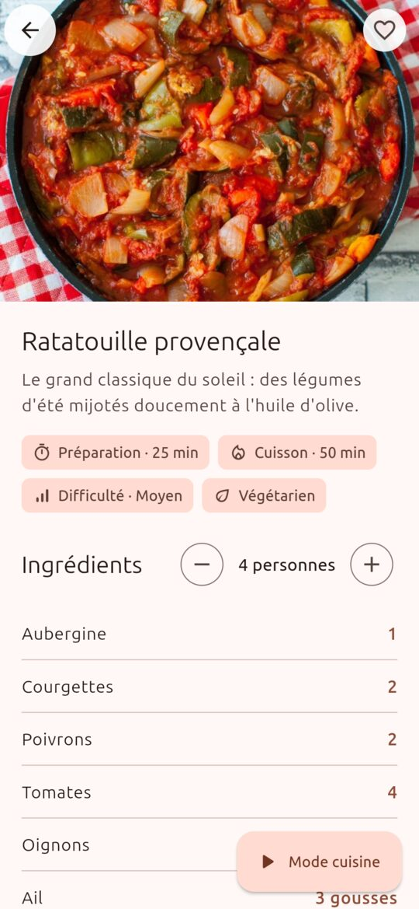
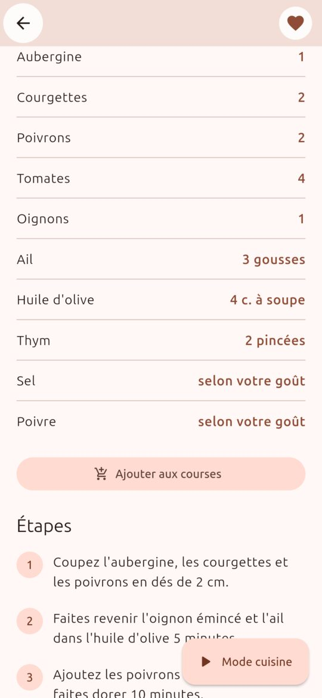
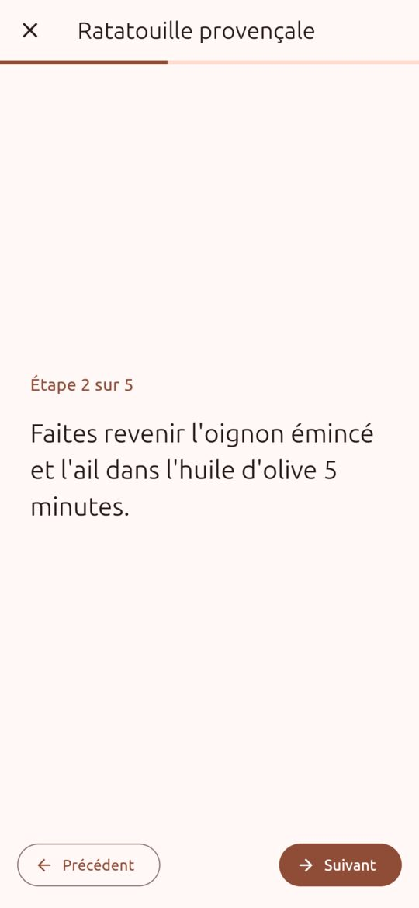
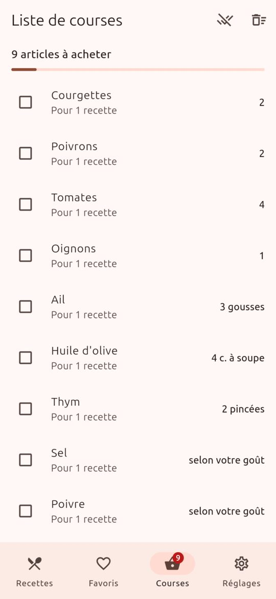
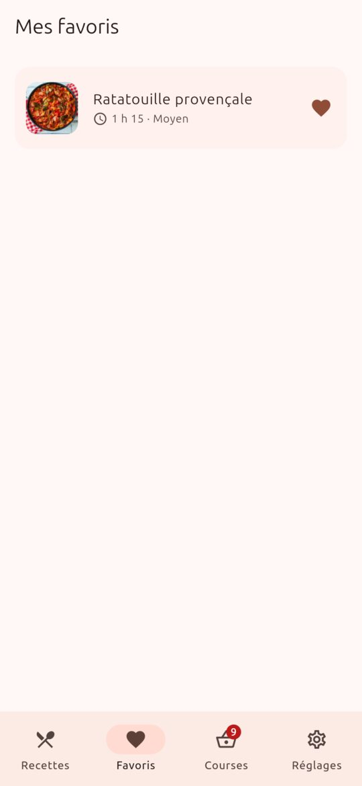
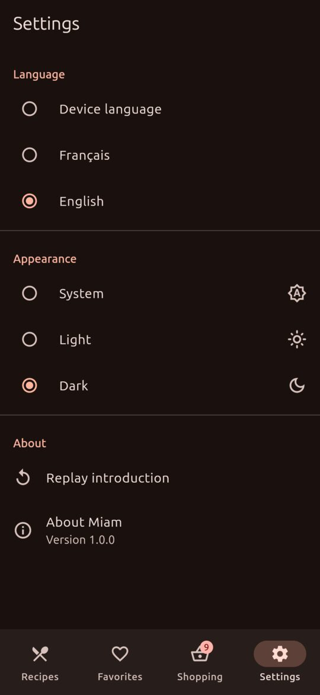
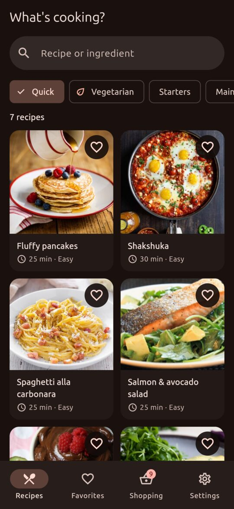
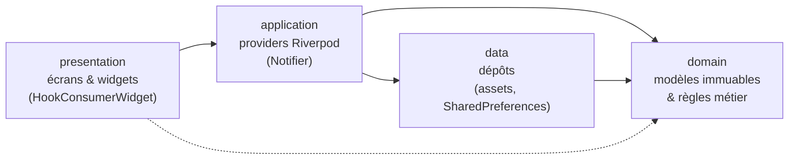

# Miam 🍲 — carnet de recettes bilingue

[](https://github.com/OWNER/miam/actions/workflows/ci.yml)


Application Flutter de recettes : catalogue filtrable, portions ajustables, mode
cuisine pas-à-pas, favoris et liste de courses qui additionne les ingrédients.
L'interface **et le contenu** sont disponibles en français et en anglais.

Le projet sert de référence « production-ready » : architecture en couches,
**95 tests** (unitaires, widgets, intégration), CI GitHub Actions, analyse
statique stricte sans avertissement, accessibilité vérifiée automatiquement et
performances mesurées en mode profile.

| Accueil | Catalogue | Détail | Ingrédients | Mode cuisine |
|:---:|:---:|:---:|:---:|:---:|
|  |  |  |  |  |

| Courses | Favoris | Réglages (EN, sombre) | Catalogue (EN, sombre) |
|:---:|:---:|:---:|:---:|
|  |  |  |  |

> Les captures sont générées par un test d'intégration sur la vraie
> application (voir [Captures d'écran](#captures-décran)).

---

## Sommaire

- [Fonctionnalités](#fonctionnalités)
- [Démarrage rapide](#démarrage-rapide)
- [Architecture](#architecture)
- [Tests](#tests)
- [Performance](#performance)
- [Accessibilité](#accessibilité)
- [Internationalisation](#internationalisation)
- [CI/CD](#cicd)
- [Captures d'écran](#captures-décran)
- [Limites connues et pistes](#limites-connues-et-pistes)

## Fonctionnalités

| # | Écran | Ce qu'il fait |
|---|---|---|
| 1 | **Introduction** | 3 pages au premier lancement, « Passer » à tout moment, rejouable depuis les réglages. |
| 2 | **Catalogue** | 18 recettes, recherche sans accents et multilingue (« boeuf » trouve « Bœuf », « beef » aussi), filtres rapide / végétarien / catégorie, grille adaptative. |
| 3 | **Détail** | Portions de 1 à 24 avec quantités recalculées et arrondies intelligemment (1 250 g → 1,25 kg, 1,6 œuf → 1½), ajout aux courses, favori. |
| 4 | **Mode cuisine** | Une étape par page en grand, navigation au doigt, aux boutons ou aux flèches du clavier. |
| 5 | **Favoris** | Du plus récent au plus ancien, balayage pour retirer avec « Annuler ». |
| 6 | **Liste de courses** | Fusion des ingrédients entre recettes, avec conversion d'unités (200 g + 1 kg = 1,2 kg). Articles cochés en bas, badge dans la navigation. |
| 7 | **Réglages** | Langue (appareil / FR / EN), thème (auto / clair / sombre), à propos et licences. |

Tout est persisté localement (`shared_preferences`) : favoris, liste de courses
et réglages survivent au redémarrage. Des données corrompues ne bloquent jamais
le démarrage.

## Démarrage rapide

**Prérequis** : Flutter **3.44.9** (stable) / Dart 3.12. Le catalogue est
embarqué dans l'app, les photos viennent du réseau (mises en cache ensuite).

```bash
git clone https://github.com/OWNER/miam.git && cd miam
flutter pub get              # génère aussi les traductions (lib/l10n/generated)
flutter run                  # Android, iOS, Web ou Linux desktop
```

| Commande | Rôle |
|---|---|
| `flutter analyze --fatal-infos` | Analyse statique (0 problème attendu) |
| `dart format --set-exit-if-changed .` | Vérifie le formatage (largeur 100) |
| `flutter test` | Tests unitaires et de widgets |
| `flutter test --coverage && dart run tool/check_coverage.dart 85` | Couverture, avec seuil |
| `flutter test integration_test/app_flow_test.dart -d linux` | Un test d'intégration (ou `-d <appareil>`) |
| `flutter drive --profile -d linux --driver=test_driver/perf_driver.dart --target=integration_test/performance_test.dart` | Mesure des frames en mode profile |
| `flutter build apk --release --split-per-abi --obfuscate --split-debug-info=build/symbols --extra-gen-snapshot-options=--strip` | APK de production (16 à 20 Mo par ABI) |

## Architecture

Organisation **par fonctionnalité**, chacune découpée en couches dont les
dépendances vont toujours vers le domaine :



```
lib/
├── main.dart                 # bootstrap() : prépare les dépendances puis runApp
├── app.dart                  # MaterialApp.router, thème, langue
├── core/
│   ├── images/               # RecipeImage (décodage à la taille affichée) + ImageUrls
│   ├── l10n/                 # context.l10n, durées, quantités et unités localisées
│   ├── providers/            # sharedPreferencesProvider (injecté au démarrage)
│   ├── router/               # go_router : shell à onglets + garde d'onboarding
│   ├── theme/                # thèmes Material 3 clair/sombre (construits une fois)
│   ├── utils/                # TextNormalizer (recherche sans accents)
│   └── widgets/              # états chargement / vide / erreur
├── features/
│   ├── recipes/              # domain (Recipe, Quantity, RecipeQuery) · data · application · presentation
│   ├── favorites/
│   ├── shopping_list/        # domain (ShoppingList : fusion, conversion d'unités)
│   ├── settings/
│   ├── onboarding/
│   └── shell/                # NavigationBar (téléphone) / NavigationRail (≥ 840 dp)
└── l10n/                     # app_fr.arb (modèle), app_en.arb, generated/
```

### Choix techniques

| Sujet | Choix | Pourquoi |
|---|---|---|
| État | **Riverpod 3** (`Notifier`, `FutureProvider`, `select`, familles `autoDispose`) | Injection testable (`overrides`), rebuilds ciblés, pas de `BuildContext` dans la logique |
| État local d'UI | **flutter_hooks** (`useState`, `useMemoized`, `useTextEditingController`, `usePageController`) | Pas de `StatefulWidget` verbeux, libération automatique des contrôleurs |
| Navigation | **go_router 18**, `StatefulShellRoute.indexedStack` | Deep links (`/recipe/:id`), onglets qui conservent leur état, garde de redirection |
| Design system | **`material_ui`** | Material est sorti du framework en Flutter 3.44 ; go_router 18 l'utilise déjà, l'app aussi (types cohérents) |
| Modèles | Classes immuables + `equatable` | Égalité par valeur : Riverpod ne notifie que les vrais changements |
| Données | Dépôts derrière des interfaces | Asset JSON aujourd'hui, API REST demain, faux dépôts en test |
| Images | `cached_network_image` + `ResizeImage` + variantes serveur | Cache disque, mémoire maîtrisée, bande passante réduite |

Toute la logique métier (mise à l'échelle, arrondis, fusion de la liste de
courses, recherche) vit dans des **classes Dart pures** du dossier `domain/`,
testables sans Flutter.

## Tests

| Type | Nombre | Où | Ce qui est couvert |
|---|---:|---|---|
| Unitaires | **59** | `test/unit/` | Domaine (quantités, arrondis, requêtes, liste de courses), dépôts (cache, erreurs, JSON embarqué valide), providers et persistance, formatage localisé, version synchronisée avec le pubspec |
| Widgets | **33** | `test/widget/` | Chaque écran, recherche avec anti-rebond, filtres, erreurs + nouvelle tentative, portions, snackbars, glisser-annuler, changement de langue et de thème, navigation adaptative, **audit d'accessibilité de chaque écran** |
| Intégration | **3** | `integration_test/` | Parcours complet avec redémarrage à froid, langue et thème de bout en bout, performance du défilement |

- **Couverture : 93,4 %** des lignes, hors code généré. La CI échoue sous 85 %.
- Les tests n'accèdent jamais au réseau : dépôt en mémoire, images de 1 px,
  `SharedPreferences` simulé.
- `isFavoriteProvider` a un test dédié : basculer une recette ne notifie
  aucune autre carte, ce qui garantit l'absence de rebuilds inutiles.

## Performance

Mesures `flutter drive --profile` sur Linux desktop (Intel Iris Xe), trois
allers-retours de défilement rapide du catalogue, 230 frames :

| Indicateur | Construction (thread UI) | Rasterisation |
|---|---:|---:|
| Moyenne | 0,57 ms | 2,65 ms |
| 99e centile | 3,79 ms | 6,23 ms |
| Pire frame | 4,27 ms | 7,7 à 15,4 ms selon les exécutions |
| **Frames hors budget (16,7 ms)** | **0** | **0** |

Le test `integration_test/performance_test.dart` fait respecter ce budget en CI.
Les résumés sont publiés comme artefact `frame-timings`.

Optimisations en place :

- **Listes paresseuses** : `SliverGrid.builder` et `SliverList.builder` ne
  construisent que les éléments visibles. Les images hors écran ne sont jamais
  chargées.
- **Images optimisées** : décodage à la taille réellement affichée
  (`ResizeImage`, largeur arrondie par paliers de 100 px pour mutualiser le
  cache), variante serveur la plus légère (`/medium` = 46 Ko au lieu de 145 Ko),
  cache disque, fondu d'apparition sans reconstruire le parent.
- **Rebuilds ciblés** : `ref.watch(provider.select(...))` partout où c'est
  pertinent. Le cœur favori n'écoute que sa recette, le badge du panier
  uniquement le nombre d'articles, `MaterialApp` uniquement le thème et la
  langue. Constructeurs `const` imposés par le lint.
- **Travail hors du thread UI** : le JSON du catalogue est décodé dans un
  isolate (`compute`) puis mis en cache.
- **Recherche avec anti-rebond** (300 ms) : un seul filtrage par saisie, et
  seul le champ se reconstruit pendant la frappe.
- Thèmes `static final`, calculs coûteux mémorisés (`useMemoized`).

## Accessibilité

- Chaque écran passe automatiquement les recommandations
  `androidTapTargetGuideline`, `iOSTapTargetGuideline`,
  `labeledTapTargetGuideline` et `textContrastGuideline`
  (`test/widget/accessibility_test.dart`). Ce test a d'ailleurs révélé que la
  zone sémantique du `SearchBar` Material ne fait que 24 dp de haut : il a été
  remplacé par un `TextField`.
- Libellés sémantiques sur tous les éléments interactifs : infobulles des
  boutons icônes, carte de recette lue d'un bloc (« Ratatouille provençale.
  1 h 15. Difficulté : Moyen. »), cœur annoncé comme interrupteur.
- Le sélecteur de portions est exposé comme un **curseur ajustable** (gestes
  haut / bas de TalkBack et VoiceOver).
- Zones `liveRegion` pour annoncer le nombre de résultats, la progression du
  mode cuisine et le résumé de la liste de courses.
- Titres marqués `header` pour la navigation par titres. Images décoratives
  exclues.
- Nom de chaque langue balisé dans sa langue (« English » prononcé en anglais).
- Cartes qui s'agrandissent avec la taille de police système, pour éviter tout
  débordement.

## Internationalisation

- **Interface** : `gen-l10n` avec `lib/l10n/app_fr.arb` comme modèle (chaque
  clé décrite) et `app_en.arb`. Pluriels ICU (« 1 recette / 3 recettes »,
  « gousse / gousses ») et nombres formatés selon la langue (`1,25 kg` / `1.25 kg`).
- **Contenu** : chaque texte de recette est un `LocalizedText`
  (`{"fr": …, "en": …}`), avec repli sur l'anglais.
- La langue suit l'appareil, sauf choix explicite dans les réglages.

**Ajouter une langue** : créer `lib/l10n/app_xx.arb`, lancer
`flutter gen-l10n`, ajouter une valeur à `LanguagePreference` et les traductions
dans `assets/data/recipes.json`.

## CI/CD

[`.github/workflows/ci.yml`](.github/workflows/ci.yml) s'exécute à chaque push
sur `main` et sur chaque pull request :

| Job | Étapes |
|---|---|
| **Lint & analyse** | `dart format` (échec si non formaté) · traductions générées à jour · `flutter analyze --fatal-infos --fatal-warnings` |
| **Tests** | `flutter test --coverage` · seuil de couverture 85 % · artefact `lcov.info` |
| **Intégration** | Linux desktop sous Xvfb : parcours utilisateurs, puis performance en mode profile |
| **Build** | APK release par ABI (obfusqué, symboles séparés pour la symbolication) et build Web, publiés en artefacts (après lint et tests) |

Dependabot met à jour chaque semaine les paquets pub et les actions GitHub.
L'analyse statique active `strict-casts`, `strict-inference`,
`strict-raw-types` et une trentaine de règles de lint en plus de
`flutter_lints`.

## Captures d'écran

Elles sont produites par un test d'intégration qui pilote la vraie application,
avec les vraies photos, dans un format téléphone de 390 × 844 dp :

```bash
flutter test integration_test/screenshots/screenshots_test.dart -d linux \
  --dart-define=SCREENSHOT_DIR=$PWD/docs/screenshots
# puis compression en JPEG (ImageMagick) :
cd docs/screenshots && for f in *.png; do convert "$f" -resize 540x -quality 82 "${f%.png}.jpg" && rm "$f"; done
```

Sans `SCREENSHOT_DIR`, ce test est ignoré : il ne tourne jamais en CI.

## Limites connues et pistes

- **Signature Android** : le build release utilise encore la clé de debug du
  template. Pour publier, configurez un keystore (`android/key.properties`) et
  le job de build.
- **Photos** hébergées par TheMealDB : il faut du réseau au premier affichage,
  ensuite elles sont en cache disque.
- Pas encore de remontée d'erreurs en production (Sentry / Crashlytics) ni
  d'analytics : les points d'entrée sont `bootstrap()` et `FlutterError.onError`.
- Les tests d'intégration tournent sur Linux desktop en CI. Ils fonctionnent
  aussi sur émulateur Android ou simulateur iOS (`-d <appareil>`).

## Crédits et licence

Photos : [TheMealDB](https://www.themealdb.com). Textes des recettes rédigés
pour l'application. Code sous licence [MIT](LICENSE).
